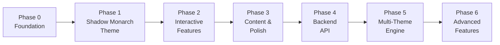

# 🌑 The Shadow Academic — Vision & Preparation Roadmap

## Shared Understanding (from our interview)

| Decision | Answer |
|:---|:---|
| **Experience Level** | Comfortable with HTML/CSS/JS; learning Next.js, TypeScript, FastAPI, Docker as we build |
| **Learning Style** | "Teach me to fish" — explain every line and every *why* |
| **Stack Phasing** | Frontend-first (Next.js + static data) → Backend (FastAPI) later |
| **Primary Theme** | Shadow Monarch 🌑 (dark RPG, cyan/purple glow, system windows) |
| **Other Themes** | Autumn Academia & Winter Editorial built after Shadow Monarch is solid |
| **Hosting** | Cloudflare Pages (SSR support, free tier, domain already on Cloudflare) |
| **Domain** | nischal.info.np (CNAME already configured) |
| **Projects to Showcase** | 1-2 real projects now, more added over time |
| **Responsiveness** | Mobile-first responsive from day one |
| **SEO** | Full metadata, Open Graph, Lighthouse optimization |
| **Animation** | Framer Motion for UI theatrics + CSS for simple transitions; Canvas particle system stays dependency-free |
| **Repo Structure** | Monorepo skeleton from the start (frontend/ + backend/ + docs/) |
| **Pace** | 2-4 hours/week, milestones sized for single sessions |

---

## 🎯 The Vision

**The Shadow Academic** is a portfolio that doesn't just *show* your work — it *performs* it. When a recruiter or collaborator lands on your site, they don't see a template. They see a **living system** — glowing borders materializing, shadow particles rising, a terminal that responds to commands, skills rated like an RPG character sheet.

### The Journey (Phased)

---

## 📋 Phase Breakdown

### Phase 0 — Foundation & Scaffolding (1-2 sessions)
> [!IMPORTANT]
> This phase is pure setup. No visuals yet — just making sure everything compiles, lints, and deploys.

- **Milestone 0.1**: Monorepo skeleton — `frontend/`, `backend/` (empty), `docs/`
- **Milestone 0.2**: Next.js 15 + TypeScript strict + Tailwind CSS + ESLint/Prettier initialization
- **Milestone 0.3**: Google Fonts setup (Cormorant Garamond, JetBrains Mono, Inter)
- **Milestone 0.4**: CSS custom properties for Shadow Monarch color tokens
- **Milestone 0.5**: First deploy to Cloudflare Pages (blank page with correct fonts = success)

**You'll learn**: Next.js App Router structure, TypeScript config, Tailwind setup, Cloudflare Pages deployment

---

### Phase 1 — Shadow Monarch Theme: Layout & Sections (3-4 sessions)
Build the visual skeleton section by section, with static/hardcoded data.

- **Milestone 1.1**: Master Layout (`layout.tsx`) — dark background, nav bar, font system
- **Milestone 1.2**: Navbar — minimalist editorial nav with glow hover effects
- **Milestone 1.3**: Hero Section — "Hunter Profile" system window, editorial headline, animated entrance
- **Milestone 1.4**: Armory Section — project cards with Solo Leveling "system window" styling, locked quest slot
- **Milestone 1.5**: Skill Matrix — S-Rank / A-Rank badge system, interactive hover states
- **Milestone 1.6**: Contact Quest — gamified contact form (styled as a "System Quest")
- **Milestone 1.7**: Footer & responsive pass across all sections

**You'll learn**: React components, TypeScript interfaces, Tailwind responsive design, Framer Motion basics

---

### Phase 2 — Interactive Features (3-4 sessions)
The features that make this portfolio *alive*.

- **Milestone 2.1**: HTML5 Canvas Particle Engine — rising shadow aura particles behind the hero
- **Milestone 2.2**: Framer Motion entrance animations — sections animate on scroll
- **Milestone 2.3**: Command Terminal (Ctrl+K modal) — `help`, `whoami`, `skills` commands with static responses
- **Milestone 2.4**: System window glow effects — border animations, hover pulse, focus states

**You'll learn**: HTML5 Canvas API, requestAnimationFrame, React portals/modals, keyboard event handling

---

### Phase 3 — Content, SEO & Polish (2-3 sessions)
Fill in real content, optimize for search and social sharing.

- **Milestone 3.1**: Real project data (descriptions, tech stacks, links/screenshots)
- **Milestone 3.2**: SEO metadata — Next.js `generateMetadata`, OpenGraph images, structured data
- **Milestone 3.3**: Lighthouse audit — performance, accessibility, best practices
- **Milestone 3.4**: Final responsive polish, cross-browser testing

**You'll learn**: Next.js metadata API, image optimization, web performance, accessibility

---

### Phase 4 — Backend API (3-4 sessions) *(future)*
FastAPI microservice for dynamic features.

- **Milestone 4.1**: FastAPI project setup + Docker Compose (FastAPI + PostgreSQL + Redis)
- **Milestone 4.2**: Database models (Project, Skill, QuestInquiry) + Alembic migrations
- **Milestone 4.3**: API routes — `/api/v1/health`, `/api/v1/projects`, `/api/v1/skills`
- **Milestone 4.4**: Contact Quest endpoint — `POST /api/v1/quests` with Redis rate limiting
- **Milestone 4.5**: Terminal service — `POST /api/v1/terminal/exec` (deterministic command parser)
- **Milestone 4.6**: Connect frontend to live API, remove static data

**You'll learn**: Python FastAPI, Pydantic, async SQLAlchemy, Docker Compose, REST API design

---

### Phase 5 — Triple Theme Engine *(future)*
- **Milestone 5.1**: Theme switching infrastructure (React Context + CSS custom property swap)
- **Milestone 5.2**: Autumn Academia theme — warm tones, serif elegance, ember particles
- **Milestone 5.3**: Winter Editorial theme — crisp slate, frost particles, minimal layout

---

### Phase 6 — Advanced Features *(future)*
- Ambient audio player
- Project modal with Mermaid architecture diagrams
- Live JSON viewer in project details
- Page transitions

---

## 🛠️ Skills & Tools Useful for Development

### Already Available (Installed Skills)

| Skill | How it helps |
|:---|:---|
| **task-planner** | Enforces milestone-by-milestone execution discipline — perfect for this project's pace |
| **thesis-builder** | Diagram generation (Mermaid ERD/DFD) — useful for the architecture docs in Phase 4 |

### Recommended New Skills to Create

> [!TIP]
> These custom skills would make the journey smoother. We can create them before starting.

#### 1. `portfolio-design-system` (Recommended — create before Phase 1)
**What it does**: A living reference for The Shadow Academic's design tokens — colors, typography scales, spacing, border effects, glow keyframes, and component patterns. Acts as a single source of truth so every milestone builds consistently.
**Why**: Without this, design decisions get scattered across CSS files and components. Having it centralized means any future theme or component pulls from the same token set.

#### 2. `nextjs-learner` (Recommended — create before Phase 0)
**What it does**: Curated Next.js 15 App Router reference — file-based routing, server vs client components, `layout.tsx` vs `page.tsx`, `generateMetadata`, image optimization, font loading. Focused on what you'll actually use, not the full docs.
**Why**: Next.js has a steep learning curve. A focused skill prevents you from falling into outdated Pages Router patterns or misusing server/client components.

#### 3. `canvas-particle-engine` (Optional — create before Phase 2)
**What it does**: Reference patterns for building performant HTML5 Canvas particle systems in React — lifecycle management, `requestAnimationFrame` loop, responsive resizing, particle pooling, and theme-switchable behaviors.
**Why**: Canvas + React is notoriously tricky (canvas doesn't re-render like DOM). Having patterns ready prevents performance pitfalls.

#### 4. `cloudflare-pages-deploy` (Optional — create before Phase 0)
**What it does**: Step-by-step deployment checklist for Next.js on Cloudflare Pages — build config, `@cloudflare/next-on-pages`, environment variables, custom domain wiring, preview deployments.
**Why**: Cloudflare Pages + Next.js has specific adapter requirements that differ from Vercel. A skill prevents deploy-day surprises.

### Marketplace Plugins Worth Considering

| Plugin | Why |
|:---|:---|
| **Figma** | If you create mockups in Figma before building, this plugin can help translate designs to code |

---

## 🎨 Design Preparation (Before We Start Coding)

> [!WARNING]
> The design isn't finalized yet. Before Phase 1, we need to lock down these decisions.

### Decisions to Make Before Phase 1

1. **Shadow Monarch Color Palette** — The goal.md suggests some colors, but are these final?
   - Primary glow: `#38BDF8` (cyan) or `#0284C7` (sky blue)?
   - Accent aura: `#7C3AED` (purple) or `#06B6D4` (teal)?
   - Background: Pure black `#000000` or near-black `#0A0A0F`?
   - Text: Pure white or warm off-white?

2. **Typography Scale** — Font sizes, line heights, and heading hierarchy

3. **Component Patterns** — What does a "system window" border look like exactly? Solid? Gradient? Animated glow?

4. **Reference Gathering** — Collect 3-5 screenshots of Solo Leveling system UI that capture the vibe you want

5. **Logo** — Keep the existing `Nischal_logo.png` or redesign?

### Recommended Preparation Steps

- [ ] Gather 5-10 Solo Leveling screenshots showing system windows, rank badges, and UI you like
- [ ] Pick 2-3 portfolio sites you admire (for layout/UX inspiration, not theme)
- [ ] List your real skills with self-assessed ranks (S/A/B) for the Skill Matrix
- [ ] Write 2-3 sentence descriptions for each project you want to showcase
- [ ] Decide if the existing logo fits the Shadow Monarch aesthetic

---

## 📅 Realistic Timeline (at 2-4 hrs/week)

| Phase | Sessions | Calendar Estimate |
|:---|:---|:---|
| Phase 0 — Foundation | 1-2 | Weeks 1-2 |
| Phase 1 — Shadow Monarch Layout | 3-4 | Weeks 3-6 |
| Phase 2 — Interactive Features | 3-4 | Weeks 7-10 |
| Phase 3 — Content & Polish | 2-3 | Weeks 11-13 |
| **v1 Launch** 🚀 | — | **~3 months** |
| Phase 4 — Backend | 3-4 | Weeks 14-17 |
| Phase 5 — Multi-Theme | 2-3 | Weeks 18-20 |
| Phase 6 — Advanced | ongoing | — |

> [!NOTE]
> These are rough estimates. Some milestones will go faster, some slower. The beauty of the milestone system is that you always have a working, deployable site — even after Phase 0.

---

## ✅ Next Steps (What to Do Before Session 1)

1. **Review this roadmap** — Does the phasing feel right? Any sections you want to move earlier/later?
2. **Gather design references** — Solo Leveling screenshots, portfolio sites you admire
3. **Prepare your project content** — Descriptions, tech stacks, links for 1-2 projects
4. **Decide on skills to create** — Which of the 4 suggested skills should we build?
5. **When you're ready**, say "Let's start Phase 0" and we begin the first milestone
